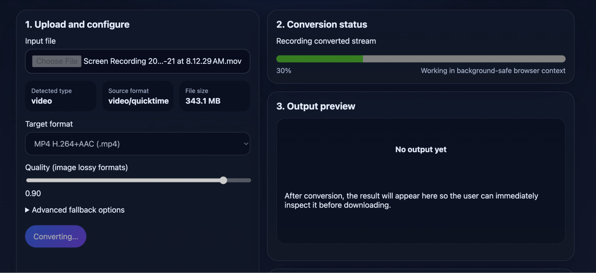

# LocalMorph

A React + TypeScript + Vite client-side file converter for GitHub Pages.

[Get the official LocalMorph desktop app for Windows on the Microsoft Store](https://apps.microsoft.com/detail/9PM1NHPT1JR5).
Convert media locally, batch files, use quick presets, and trim clips. FFmpeg and FFprobe are
installed separately; the desktop app's Tools page provides WinGet and manual setup guidance.
The browser converter remains available at [localmorph.com](https://localmorph.com).



## Stack

- React 19
- TypeScript
- Vite
- Browser-native conversion paths with an optional local FFmpeg bridge

## Features

- Dedicated landing page that explains privacy, performance, and the conversion flow
- Separate converter workspace focused on upload, route clarity, status, and preview
- Built-in Privacy Policy and Terms of Use pages for static deployments
- Image conversion via Canvas export
- Audio/video conversion via `MediaRecorder` when supported by the browser
- Optional LocalMorph Bridge integration for FFmpeg conversion on the same device
- GitHub Pages deployment workflow

## Local development

```bash
npm install
npm run dev
```

## Production build

```bash
npm run build
```

## Windows launch video

The landing page includes a click-to-play, 30-second 1080p launch film:
[`public/media/localmorph-windows-launch.mp4`](public/media/localmorph-windows-launch.mp4).
It uses two actual Windows app screenshots, animated local-conversion routes, a moving batch queue,
trim/split and waveform graphics, and an original,
procedurally composed 80 BPM instrumental; no stock music or external media services are used.
The end card points to **localmorph.com**. The poster, English WebVTT captions, and an inline
transcript ship with the website. The video
does not autoplay or enter the PWA precache, so opening the converter does not download the film.

To regenerate it on Windows, install Python's Pillow and NumPy packages and put FFmpeg and
FFprobe on PATH, then run:

```powershell
python .\scripts\render-launch-video.py
```

The renderer uses the existing Store screenshot assets, the desktop app's Open Sans font files,
and Windows Bahnschrift. It writes the MP4 and poster into `public/media`, verifies the media
format and duration, and saves a storyboard and probe report under ignored
`artifacts/desktop-launch`. Keep the captions and on-page transcript in sync if changing the film.

## Optional LocalMorph Bridge

For conversions that need FFmpeg, install the
[.NET 10 SDK](https://dotnet.microsoft.com/download/dotnet/10.0) and FFmpeg
separately, then run the lightweight LocalMorph Bridge on the same Windows,
macOS, or Linux device. On Windows, the SDK is also available through Winget:

```powershell
winget install --id Microsoft.DotNet.SDK.10 -e --source winget
```

Verify `dotnet --version` reports 10.x before starting the bridge:

```bash
dnx LocalMorph.Bridge
```

Alternatively, install it permanently with:

```bash
dotnet tool install --global LocalMorph.Bridge
localmorph-bridge
```

The website can copy the command with one click. Browsers cannot execute local
terminal commands directly, including through Windows Terminal, without a
separately installed protocol handler. Paste the copied command into your
terminal, then copy the complete `LOCALMORPH_BRIDGE={...}` startup line and
paste it once into the converter settings. LocalMorph validates the loopback
URL and fills in both connection values. The bridge package does not
redistribute FFmpeg.

## LocalMorph Desktop (.NET MAUI)

[`LocalMorph.App`](dotnet/src/LocalMorph.App) is a native .NET MAUI desktop app for Windows and
macOS. Each import accepts up to **2,000 supported files**, with folder traversal through eight
levels. Further imports can extend the queue; duplicates do not consume the import allowance.

- **Batch queue** — add files or whole folders, drag & drop, "Open with" from Explorer/Finder, or pass
  paths on the command line (`LocalMorph.App.exe video.mov photo.heic`). The app is single-instance:
  opening more files while it's running adds them to the existing queue. Files convert in parallel
  with live progress, speed, and ETA; cancel any job or all of them.
- **Clear batch scope** — one output format per batch, with preflight explaining ineligible files.
  Trim and track choices belong to the selected file; other conversion settings apply to the batch.
  Import and inspection are cancellable, and the import summary reports exclusions and errors.
- **Join and split** — join compatible video clips in queue order using Remux, without re-encoding.
  Mismatched streams are rejected rather than silently transcoded. Split by source-timeline duration:
  accurate mode re-encodes; fast mode copies streams at source keyframes and may produce longer clips.
  Completed clips remain available if a later clip fails or is canceled.
- **Measured audio and HDR** — optional two-pass loudness normalization measures every retained
  audio track (default -16 LUFS, -1.5 dBTP). Audio outputs can trim leading/trailing silence while
  preserving internal pauses; entirely silent inputs report an error. PQ/HLG video can be explicitly
  tone-mapped to BT.709 SDR when FFmpeg has the required filters.
- **50+ output formats** — MP4 (H.264/H.265/AV1), MKV, MOV/ProRes, WebM, GIF, animated WebP/APNG,
  MP3, AAC, FLAC, ALAC, Opus, OGG, WAV/AIFF, PNG, JPEG, WebP, AVIF, JPEG XL, TIFF, BMP, ICO, HEIC,
  plus PDF/DOCX/XLSX/PPTX/ODT/EPUB/Markdown/HTML document conversion.
- **Quick presets** — Share anywhere, Fit in 25 MB (two-pass), Shrink with HEVC, GIF loop,
  Extract audio, Remux, Vertical 9:16, Square 1:1, Mute video, Contact sheet, Extract subtitles,
  Waveform, Grab a frame, Podcast, Favicon, Save as PDF, and more.
- **Fine control** — quality, resolution (never upscales), frame rate, encoding speed, audio
  bitrate/sample rate/channels/bit depth, loudness normalization, trim from the media preview,
  frame grab at the current position, rotate, playback speed, strip metadata, lossless toggles.
- **Roomier preview** — image/video previews grow with the window. Expand/collapse the bottom
  inspector without restarting playback; the queue, preview header, and Convert action remain reachable.
- **Adaptive settings panel** — Task, presets, output settings, and the Convert action widen together
  with the window, while keeping the queue and preview in the larger share of the workspace.
- **Audio tracks** — see every track with its language, channels, and title; keep just one (pick a
  language, drop the commentary), keep them all with your choice first and default, save any track as
  its own audio file, or **replace the soundtrack** with a new audio file (stream-copying the video).
- **Subtitles** — keep embedded tracks (MKV keeps everything; MP4/MOV get text tracks as `mov_text`),
  remove them, add an `.srt`/`.vtt`/`.ass` file as a selectable track, or **burn** a track or file into
  the picture (text via libass, PGS/VobSub via overlay). Extract a subtitle track to SRT/VTT/ASS, or
  convert subtitle files between those formats.
- **Edit & effects** — crop to 16:9, 9:16, 1:1, 4:5, 4:3, or 21:9 (center crop), mirror/flip,
  deinterlace, denoise, fade in/out (video and audio), reverse, volume, and audio-sync offset.
- **Extras** — a 4×4 **contact sheet** of thumbnails across a video, and a **waveform** PNG of any
  audio (or a video's chosen audio track).
- **Hardware encoding** — NVIDIA NVENC, Intel Quick Sync, AMD AMF, and Apple VideoToolbox are
  detected with a real test encode and used automatically when they work.
- **Development/Windows Tools view** — finds FFmpeg, ImageMagick, LibreOffice, Pandoc, and Ghostscript on PATH, in
  winget/Homebrew/Program Files locations, or bundled with the app; one-click install via
  `winget`/`brew` where available. On Windows, install Ghostscript from its
  [official website](https://ghostscript.com/releases/gsdnld.html), then select **Refresh**.
  The Tools page explains that third-party tools and codecs have their own developers,
  licenses, and terms; format availability depends on the installed or bundled tools.
- **macOS built-in converters (Mac App Store)** — the sandboxed Mac app can't run user-installed
  tools, so it uses Apple's ImageIO, Core Graphics, and text system instead of ImageMagick,
  LibreOffice, Pandoc, and Ghostscript. It converts HEIC/HEIF, RAW, PSD, WebP, AVIF, and common
  images to PNG/JPEG/TIFF/HEIC/AVIF/GIF/BMP/ICO/PDF; renders the first page of a PDF to an image;
  and turns Markdown/HTML/RTF/TXT into PDF/RTF/HTML/TXT. DOCX/ODT/EPUB/Markdown output, WebP/JXL
  output, PDF compression, and SVG/EPS input stay unavailable on Mac and are labeled as such.
- **HEIC on Windows** — HEIC/HEIF photos decode natively through the Windows **HEIF Image
  Extensions** codec (Windows Imaging Component), no ImageMagick needed for PNG/JPEG/BMP/TIFF/GIF
  output. If the codec is missing, the Tools view and the queue show a *Get from Store* action that
  opens its Microsoft Store page. (Most iPhone photos also need the free "HEVC Video Extensions from
  Device Manufacturer"; the Tools view tells you when that decoder is absent.)
- **Safe results** — conversions stage beside the destination and commit only after success.
  Existing destinations survive failures/cancellation; queued source files are protected even with
  Overwrite. Target-size limits use decimal MB (1 MB = 1,000,000 bytes) and budget retained audio tracks.
- **Queue and history menus** — source/result actions, diagnostics, retry/cancel/remove, and queue
  ordering. History remembers ordered inputs, requested settings, multiple outputs, and partial
  results. Removing history never deletes result files.
- **Windows Explorer command** — MSIX builds register **Convert with LocalMorph** for supported
  files. Selection is queued in the existing instance, never auto-converted; default associations
  are not changed. Installed-package activation still requires release validation.
- **Command preview** — inspect/copy the planned conversion; analysis-dependent operations explain
  their stages. Completed-job diagnostics retain the actual analysis and rendering commands.
- **About & feedback** — the About tab shows the installed app version, build number, and
  Refractored LLC copyright notice, with links to the website, GitHub project, and
  [privacy policy](https://localmorph.com/#/privacy). Its Bug / Feature request form opens a
  prefilled public GitHub issue with your title, details, app version/build, and OS information.
  Review and submit it on GitHub; a GitHub account is required. No files or logs are attached.
  Drafts stay in memory across tab switches and after opening GitHub, but are not saved across
  app restarts. Oversized browser links are rejected without truncating the draft.

Build and run on Windows:

```powershell
dotnet build .\dotnet\src\LocalMorph.App\LocalMorph.App.csproj -f net10.0-windows10.0.19041.0 -p:WindowsOnly=true
dotnet test .\dotnet\tests\LocalMorph.Core.Tests   # unit + real-FFmpeg integration tests
```

Real-FFmpeg integration tests share one xUnit collection so concurrent encoders do not starve media
probes on smaller CI runners. Other test collections remain parallel; production probe timeouts and
conversion concurrency are unchanged.

Development builds need FFmpeg for media conversion (`winget install --id Gyan.FFmpeg -e --source winget` /
`brew install ffmpeg`), or platform binaries under
[`Resources/ffmpeg`](dotnet/src/LocalMorph.App/Resources/ffmpeg). Packaged Windows builds also need
Visual Studio 2022 or newer C++ tools for each target architecture to build the native Explorer DLL;
unpackaged development builds do not. Windows Store builds bundle .NET, but not FFmpeg or FFprobe.
Install both media tools through the Tools page using WinGet, or extract a full Windows FFmpeg
build so `ffmpeg.exe` and `ffprobe.exe` are together in `C:\ffmpeg\bin`, then select **Refresh**.
Manual installations on other platforms must be on PATH. Tool installation may require internet
access and acceptance of the tool publisher's licenses.

The Mac App Store build bundles its own FFmpeg (with libass and zscale); nothing needs installing.
For development on macOS, HDR tone mapping and the full Core integration suite require `brew install ffmpeg-full`.
Its keg-only binaries must be on PATH: `export PATH="$(brew --prefix ffmpeg-full)/bin:$PATH"`.
The standard Homebrew `ffmpeg` build does not include the required `zscale` filter.

The Mac app targets **macOS 15+ on Apple Silicon only** (Mac Catalyst 18.0 / `maccatalyst-arm64`).
Its CI uses Xcode 27 on macOS 27 with a compatible pinned .NET workload; this does not raise
the installation minimum to macOS 27. See the [Mac toolchain runbook](docs/release-setup.md#macos-toolchain)
for the exact versions and scene-lifecycle/runtime gates. Intel Mac packages are not planned.

### Install the desktop app

Desktop distribution is **Store-only**:

- **Windows:** [Microsoft Store](https://apps.microsoft.com/detail/9PM1NHPT1JR5).
- **Mac:** Mac App Store delivery is being prepared; no public Mac download is available.

There are no desktop GitHub installers, LocalMorph WinGet packages, Homebrew casks, or in-app
download/update feeds. Installing FFmpeg with WinGet or Homebrew for Windows/development/bridge
use is separate from installing LocalMorph itself. Browser conversion and bridge releases remain
available.

The Windows Store workflow packages on `vX.Y.Z-windows` tags, then requires approval to submit to the
existing **Internal Testing** package flight and a second approval to submit the same upload to the
main listing. Manual package-only builds remain available. It is not release-ready until the
external-tool setup, approval, package-installation, WACK, and native-architecture checks pass.
Mac Store delivery remains blocked on sandboxed bundled-tool verification, file permissions,
component licensing, signing/provisioning, and TestFlight validation. The current development
build and host-tool tests are not evidence of Mac App Store readiness.
One-time setup (environments, secrets, Apple/Partner Center accounts):
[docs/shipping-checklist.md](docs/shipping-checklist.md); pipeline details: [docs/release-setup.md](docs/release-setup.md).

## Continuous integration

CI runs on pull requests targeting `main` and pushes to `main`, including merges.
Feature-branch pushes do not trigger CI, avoiding duplicate push and pull-request runs.
Bridge CI runs when changes include `dotnet/**`, `README.md`, release-tag helpers,
Windows/Mac helpers, helper tests, Store workflows, or `.github/workflows/bridge-ci.yml`;
retired cask/feed paths and other workflow changes also run the guards. Web CI runs for all changes.

## Deployment

Push to `main` and GitHub Actions will build and publish `dist/` to GitHub Pages.

### Custom domain

This repo now includes `public/CNAME`, so each production build publishes the custom domain
`localmorph.com` with the site artifact.

To finish the setup in GitHub Pages:

1. Open the repository `Settings` → `Pages`.
2. Set the custom domain to `localmorph.com`.
3. Enable `Enforce HTTPS` after DNS finishes propagating.

DNS should point the domain at GitHub Pages:

- For the apex domain `localmorph.com`, use GitHub Pages-supported `A`/`AAAA` records or an
  `ALIAS`/`ANAME` record if your DNS provider supports it.
- For `www.localmorph.com`, add a `CNAME` to your GitHub Pages host and optionally redirect
  `www` to the apex domain.

## Branding and legal pages

The app is branded as `LocalMorph` and includes hash-routed `Privacy Policy` and `Terms of Use`
pages so they work on static hosting without additional server routes.

## Manual smoke checklist

1. Run `npm run dev` and verify the app loads.
2. Convert PNG/JPEG/WebP image through the native route.
3. Convert a small audio/video file where `MediaRecorder` support is reported.
4. Start LocalMorph Bridge with FFmpeg on `PATH`, pair it in the converter settings, and verify
   that the Local FFmpeg Bridge route completes.
5. Try an unsupported output with browser-only mode and confirm the app reports it as unsupported.
6. Run the deployed site in Chromium, Firefox, and Safari.

## Known constraints

- MediaRecorder-based audio/video conversion remains browser-dependent.
- Native encoding support varies by browser and installed codecs.
- Local FFmpeg Bridge is an optional, separately started companion. It requires FFmpeg to be
  installed and available on the bridge process's `PATH`.
- The bridge uses a per-launch URL/token pair and loopback connection. Files are sent only to that
  running process on the same device, never to a managed application server; the bridge retains
  completed, failed, and canceled job files for up to one hour before cleanup.
- The included privacy and terms copy is product-facing starter content and should be reviewed
  before production/legal use.
